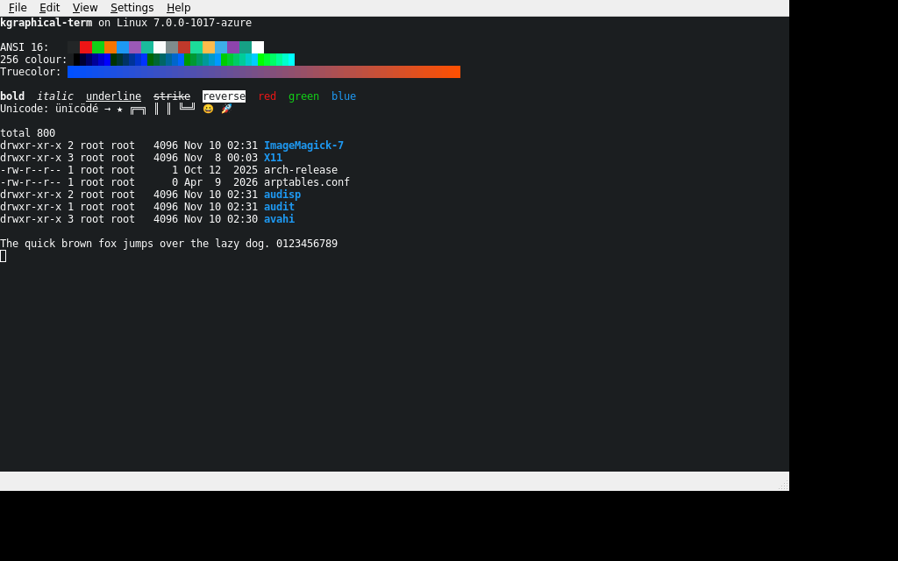

# kgraphical-term

A GPU-accelerated terminal emulator built on **KDE Frameworks 6** and **Qt 6**.

- Terminal emulation by [libvterm](https://www.leonerd.org.uk/code/libvterm/) (xterm-256color, truecolor, alt screen, bracketed paste, mouse reporting)
- Pseudo-terminal and process handling by KDE's **KPty**
- Window, menus, actions and shortcuts by **KXmlGui**, settings by **KConfig**, strings by **KI18n**
- Rendering on **OpenGL** or **Vulkan** (via Qt's QRhi), with a QPainter software fallback

## Download

Every push to `main` builds an AppImage and publishes it to the
[Releases](../../releases) page (the rolling **Continuous build**); pushing a `v*` tag
publishes a regular release.

```sh
chmod +x kgraphical-term-*-x86_64.AppImage
./kgraphical-term-*-x86_64.AppImage
```

The AppImage bundles Qt, KDE Frameworks and libvterm, and uses your system's graphics drivers.
It is built on Arch Linux, so it needs a distribution with a recent glibc (the exact version is in
each release's notes).

## Screenshots

Rendered in CI under Xvfb, with Mesa's software rasterisers standing in for a GPU
(llvmpipe for OpenGL, lavapipe for Vulkan):

| Software | OpenGL | Vulkan |
| --- | --- | --- |
|  |  |  |

## Rendering

The GPU path uses `QRhiWidget`, so one renderer and one set of shaders runs on both APIs:

1. Glyphs are rasterised once with QPainter into an atlas texture (2048×2048).
2. Every frame, the visible cells become a flat array of instances (cell rectangle, atlas rectangle, foreground, background).
3. The whole screen is drawn with a **single instanced draw call**.

Shaders live in `shaders/` and are compiled at build time by `qt_add_shaders` into SPIR-V (Vulkan) and GLSL 150/120/100 es (OpenGL).

Pick a backend with `--renderer`:

```
kgraphical-term --renderer opengl
kgraphical-term --renderer vulkan
kgraphical-term --renderer software
kgraphical-term --renderer auto      # default: OpenGL, then Vulkan, then software
```

or set it persistently in `~/.config/kgraphical-termrc`:

```ini
[General]
Renderer=vulkan
```

If the requested backend is not available, the next best one is used and a warning is printed. The active backend is logged at startup. Note that every tab in a window shares one backend.

## Features

- Tabs, opening in the working directory of the current tab
- 10,000 lines of scrollback (mouse wheel, `Shift+PageUp/PageDown`)
- Mouse selection, middle-click paste, context menu
- Mouse reporting for programs that use it (hold `Shift` to select instead)
- Zoom (`Ctrl++`, `Ctrl+-`, `Ctrl+0`, `Ctrl+wheel`) and a font chooser
- High-DPI aware: cells are whole device pixels
- Wide characters and colour emoji

| Shortcut | Action |
| --- | --- |
| `Ctrl+Shift+T` / `Ctrl+Shift+W` | New / close tab |
| `Ctrl+Shift+Left` / `Right` | Previous / next tab |
| `Ctrl+Shift+C` / `Ctrl+Shift+V` | Copy / paste |
| `Ctrl++` / `Ctrl+-` / `Ctrl+0` | Zoom in / out / reset |
| `F11` | Full screen |

## Building

Requirements: Qt ≥ 6.7 (including private headers and ShaderTools), KDE Frameworks ≥ 6.0
(KCoreAddons, KConfig, KI18n, KXmlGui, KPty), extra-cmake-modules, libvterm ≥ 0.3,
and for the Vulkan backend a working Vulkan driver.

Arch Linux:

```sh
sudo pacman -S base-devel cmake extra-cmake-modules qt6-base qt6-shadertools \
    kcoreaddons kconfig ki18n kxmlgui kpty libvterm
```

Debian / Ubuntu (names vary by release; Qt 6.7+ and KF6 required):

```sh
sudo apt install build-essential cmake extra-cmake-modules pkg-config \
    qt6-base-dev qt6-base-private-dev qt6-shadertools-dev \
    libkf6coreaddons-dev libkf6config-dev libkf6i18n-dev libkf6xmlgui-dev libkf6pty-dev \
    libvterm-dev
```

Then:

```sh
cmake -B build -DCMAKE_BUILD_TYPE=Release
cmake --build build -j
./build/bin/kgraphical-term        # or: sudo cmake --install build
```

## Continuous integration

`.github/workflows/ci.yml` runs on every push and pull request:

1. Builds on Arch Linux (Qt ≥ 6.7 and KF6 are not in Ubuntu LTS).
2. Launches the app under Xvfb with each backend (software, OpenGL, Vulkan), screenshots it and
   fails if the backend did not initialise or the screenshot is blank.
3. Packages an AppImage, launches it the same way, and publishes it to Releases.

Logs and screenshots of the latest run are on the `ci-output` branch (overwritten on every run)
and attached to the run as an artifact.

## Known limitations

- Colour emoji are drawn through the glyph atlas; very large glyphs are clipped to their cell.
- Every tab in a window must use the same rendering backend.
- No settings dialog yet beyond the font chooser; colours are fixed (Breeze-like palette).

## License

MIT, see [LICENSE](LICENSE).
